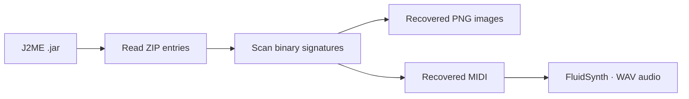

# j2me-asset-hunter
Hunt game assets from a J2ME .jar file.

## Pipeline



Recover images and MIDI from J2ME archives, with FluidSynth audio conversion. [Diagram source and validation notes](docs/showcase.md).

## Usage

```bash
./j2me-asset-hunter <your_jar_file.jar> [-o] <output_directory>
```